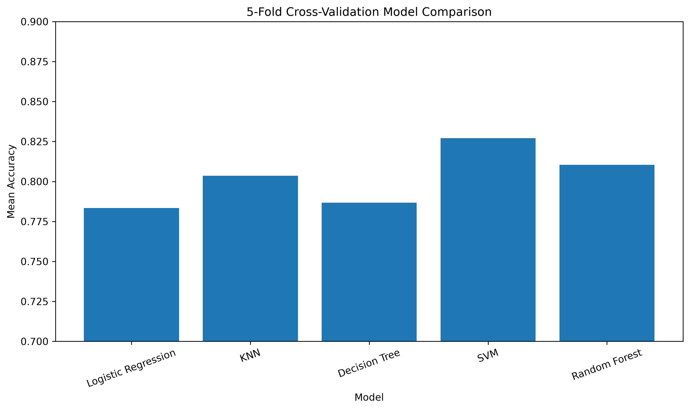
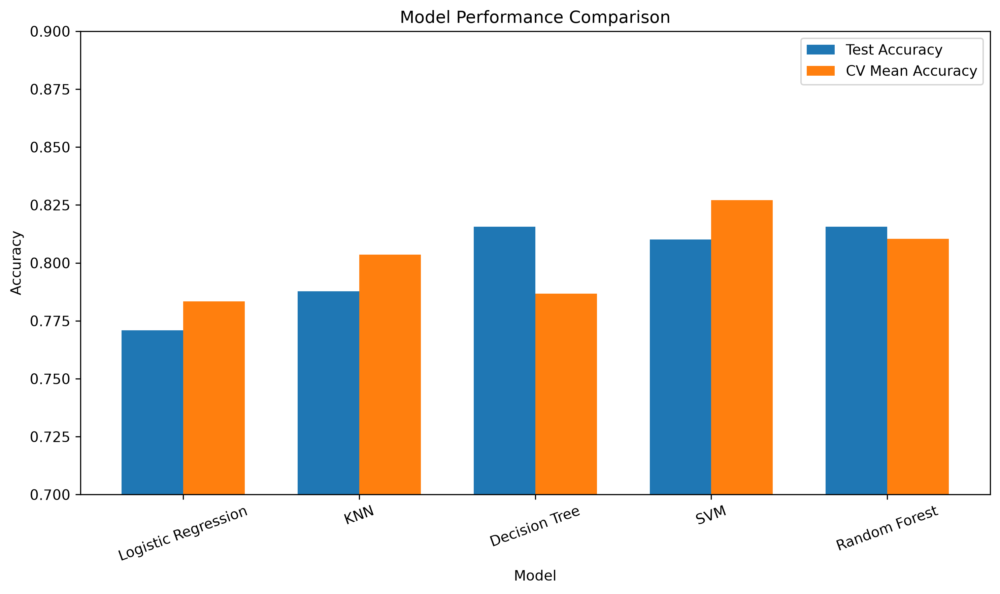

# Titanic Survival Prediction

A machine learning classification project that predicts whether a passenger survived the Titanic disaster.

## Project Overview

This project explores several machine learning algorithms on the Titanic dataset and compares their performance using both a held-out test set and 5-fold cross-validation.

The project demonstrates a complete machine learning workflow, including:

* Exploratory data analysis
* Data visualization
* Feature selection
* Missing-value handling
* Feature scaling
* Categorical feature encoding
* Machine learning pipelines
* Model training
* Model evaluation
* 5-fold cross-validation
* Hyperparameter tuning
* Model comparison

## Models

The following classification algorithms were evaluated:

1. Logistic Regression
2. K-Nearest Neighbors (KNN)
3. Decision Tree
4. Support Vector Machine (SVM)
5. Random Forest

## Dataset

The project uses the Titanic `train.csv` dataset.

The target variable is:

* `Survived`

Selected features:

* `Pclass`
* `Age`
* `Fare`
* `Sex`
* `Embarked`

The following columns were excluded from the initial modeling process:

* `PassengerId`
* `Name`
* `Ticket`
* `Cabin`

## Preprocessing

The project uses a `ColumnTransformer` and `Pipeline` to keep preprocessing and model training together.

### Numerical Features

* Missing values → median imputation
* Scaling → `StandardScaler`

### Categorical Features

* Missing values → most frequent value
* Encoding → `OneHotEncoder`

Keeping preprocessing inside the machine learning pipeline helps prevent data leakage during cross-validation.

## Model Evaluation

Models were evaluated using:

* Accuracy
* Precision
* Recall
* F1-score
* Confusion matrix
* 5-fold cross-validation

### 5-Fold Cross-Validation Results

| Model               | Mean Accuracy | Standard Deviation |
| ------------------- | ------------: | -----------------: |
| Logistic Regression |        78.34% |              0.76% |
| KNN                 |        80.36% |              2.63% |
| Decision Tree       |        78.68% |              2.76% |
| SVM                 |        82.72% |              2.13% |
| Random Forest       |        81.04% |              2.12% |

Among the tested models, SVM achieved the highest mean cross-validation accuracy of 82.72%.

## Hyperparameter Tuning

`GridSearchCV` was used to tune the SVM hyperparameters:

* `C`
* `gamma`
* `kernel`

The best configuration found during cross-validation was:

```text
C = 1
gamma = scale
kernel = rbf
```

The best cross-validation accuracy was 82.72%.

Since this was the same configuration used in the original SVM model, hyperparameter tuning did not improve the cross-validation accuracy.

## Final Model Evaluation

The tuned SVM was evaluated on the held-out test set.

| Metric    |  Score |
| --------- | -----: |
| Accuracy  | 81.01% |
| Precision | 87.23% |
| Recall    | 59.42% |
| F1-score  | 70.69% |

The model achieved relatively high precision but lower recall for the survivor class. This means that when the model predicted survival, it was usually correct, but it still missed a number of actual survivors.

## Visualizations

### Cross-Validation Model Comparison



### Final Model Comparison



## Project Structure

```text
titanic-survival-prediction/
│
├── data/
│   └── train.csv
│
├── images/
│   ├── cv_model_comparison.png
│   ├── final_model_comparison.png
│   └── cv_results.csv
│
├── titanic_ml.ipynb
├── .gitignore
├── README.md
└── requirements.txt
```

## Technologies

* Python
* Pandas
* NumPy
* Matplotlib
* Scikit-learn
* Jupyter Notebook

## What I Learned

Through this project, I practiced:

* Classification algorithms
* Train-test splitting
* Exploratory data analysis
* Data visualization
* Missing-value handling
* Categorical encoding
* Feature scaling
* Machine learning pipelines
* Cross-validation
* Hyperparameter tuning
* Model evaluation
* Comparing different machine learning models
* Avoiding data leakage during preprocessing
